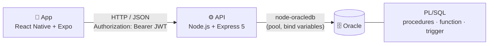

<div align="center">

# 🚨 AlertaBairro

**Rede comunitária de alerta e ajuda para eventos extremos — Global Solution 2026**

Moradores registram ocorrências (alagamento, árvore caída, falta de luz), encontram o abrigo com vaga mais próximo, pedem ou oferecem ajuda e avisam que estão bem com um toque.


[Arquitetura](#-arquitetura) · [Como rodar](#-como-rodar) · [Endpoints](#-endpoints) · [Banco](#-banco-de-dados) · [Testes](#-testes) · [Equipe](#-equipe)

</div>

---

## 📦 Estrutura do repositório

| Pasta | Conteúdo | Documentação |
|---|---|---|
| [`app/`](app/) | App mobile em React Native + Expo + TypeScript (projeto em `app/alertabairro`) | [README_APP.txt](app/README_APP.txt) |
| [`api/`](api/) | API REST em Node.js + Express + Oracle, com login JWT | [README_API.txt](api/README_API.txt) |
| [`banco/`](banco/) | Scripts Oracle: tabelas, procedures, function, trigger e testes | [README_BANCO.txt](banco/README_BANCO.txt) · [Instruções da Pessoa 4](banco/INSTRUCOES_PESSOA4.txt) |
| [`README.txt`](README.txt) | README final da entrega, juntando as seções de todos | — |
| [`links.txt`](links.txt) | Links do GitHub e dos vídeos | — |

## 🧭 Arquitetura



- O app fala **só** com a API (camada única em `src/servicos/api.ts`).
- A API valida tudo, autentica com JWT e chama as rotinas PL/SQL.
- As regras de negócio pesadas (prioridade, vagas, abrigo mais próximo) ficam no banco.

## 🚀 Como rodar

> Ordem: **banco → API → app**. Celular e computador na mesma rede Wi-Fi.

### 1. Banco (Oracle)

Rode os scripts da pasta [`banco/`](banco/): primeiro as tabelas, depois as rotinas.
O contrato exato que a API espera está em [`banco/INSTRUCOES_PESSOA4.txt`](banco/INSTRUCOES_PESSOA4.txt).

### 2. API

```bash
cd api
npm install
cp .env.example .env      # no Windows: copy .env.example .env
npm start
```

Preencha o `.env`:

| Variável | Exemplo | Para quê |
|---|---|---|
| `ORACLE_USER` / `ORACLE_PASSWORD` | `rm123456` | usuário do Oracle |
| `ORACLE_CONNECT_STRING` | `oracle.fiap.com.br:1521/ORCL` | endereço do banco |
| `JWT_SECRET` | *(mín. 32 caracteres)* | assinatura dos tokens |
| `PORT` | `3000` | porta da API |

Gere um segredo forte com:

```bash
node -e "console.log(require('crypto').randomBytes(48).toString('hex'))"
```

Teste: abra `http://localhost:3000/health` → `{"status":"ok"}`

### 3. App

```bash
cd app/alertabairro
npm install
EXPO_PUBLIC_API_URL=http://SEU_IP:3000 npx expo start
```

No PowerShell: `$env:EXPO_PUBLIC_API_URL="http://SEU_IP:3000"; npx expo start`

> 💡 Sem `EXPO_PUBLIC_API_URL` o app roda com **dados falsos** (mock), sem precisar da API.

## 🔌 Endpoints

Rotas com 🔒 exigem `Authorization: Bearer <token>`. Rotas com 🦺 são só para o perfil `voluntario`.

| Método | Rota | Descrição |
|---|---|---|
| `GET` | `/health` | Status da API |
| `POST` | `/auth/cadastro` | Cria usuário → `{ token, usuario }` |
| `POST` | `/auth/login` | Login → `{ token, usuario }` |
| `GET` | `/ocorrencias` 🔒 | Lista ocorrências |
| `POST` | `/ocorrencias` 🔒 | Registra ocorrência (`PRC_REGISTRAR_OCORRENCIA`) |
| `PATCH` | `/ocorrencias/:id` 🔒 | `confirmar` (soma relato → trigger) · `atender` 🦺 · `resolver` 🦺 |
| `GET` | `/abrigos` 🔒 | Lista abrigos |
| `GET` | `/abrigos/proximo?lat=&lng=` 🔒 | Abrigo com vaga mais perto (`FN_ABRIGO_MAIS_PROXIMO`) |
| `PATCH` | `/abrigos/:id/vagas` 🔒🦺 | Entrada/saída de pessoas (`PRC_CONTROLE_VAGAS`) |
| `GET` | `/ajuda` 🔒 | Pedidos e ofertas de ajuda, com distância |
| `POST` | `/ajuda` 🔒 | Cria pedido ou oferta |
| `POST` | `/ajuda/encerrar-antigos` 🔒🦺 | Encerra pedidos antigos (`PRC_ENCERRAR_PEDIDOS_ANTIGOS`) |
| `POST` | `/checkins` 🔒 | "Estou bem" / "Preciso de ajuda" (botão SOS) |
| `GET` | `/indicadores` 🔒 | Painel: ocorrências, ocupação dos abrigos, pedidos, check-ins |

<details>
<summary><b>Códigos de resposta</b></summary>

| Código | Quando |
|---|---|
| `200` / `201` | Sucesso |
| `400` | Dado inválido (campo faltando, coordenada fora do intervalo, JSON malformado) |
| `401` | Sem token, token inválido/expirado ou login errado |
| `403` | Perfil sem permissão |
| `404` | Registro não encontrado |
| `409` | E-mail já cadastrado |
| `422` | Regra recusada pelo banco (`RAISE_APPLICATION_ERROR -20xxx`, ex.: "Abrigo sem vagas suficientes") |
| `500` | Erro interno (detalhe só no log do servidor) |

</details>

Corpos, formatos de resposta e funções do código: [`api/README_API.txt`](api/README_API.txt).

## 🗄️ Banco de dados

| Rotina PL/SQL | Usada em |
|---|---|
| `PRC_REGISTRAR_OCORRENCIA` | `POST /ocorrencias` |
| Trigger de escalonamento (3+ relatos na mesma área) | `PATCH /ocorrencias/:id` → `confirmar` |
| `FN_ABRIGO_MAIS_PROXIMO` | `GET /abrigos/proximo` |
| `PRC_CONTROLE_VAGAS` | `PATCH /abrigos/:id/vagas` |
| `PRC_ENCERRAR_PEDIDOS_ANTIGOS` | `POST /ajuda/encerrar-antigos` |

Tabelas: `USUARIO`, `OCORRENCIA`, `ABRIGO`, `PEDIDO_AJUDA`, `CHECKIN`.
Assinaturas, colunas e códigos de erro: [`banco/INSTRUCOES_PESSOA4.txt`](banco/INSTRUCOES_PESSOA4.txt).

## 🔐 Segurança

- **Senhas** com bcrypt (custo 10, salt aleatório). Só o hash vai para o banco.
- **JWT** HS256, expira em 8h, com segredo de no mínimo 32 caracteres.
- **Login** com a mesma mensagem e o mesmo tempo de resposta para e-mail inexistente e senha errada.
- **SQL** sempre com *bind variables*, sem concatenar texto (protege contra SQL injection).
- **Privacidade:** a API não devolve a localização de quem pediu ajuda, só a distância ("300 m").
- `.env` fora do Git. Erros internos não vazam detalhes ao cliente.

## 🧪 Testes

```bash
cd api
npm test
```

| Arquivo | O que cobre |
|---|---|
| `test/integracao.test.js` | Fluxo completo do app: cadastro → login → ocorrências → abrigos → check-in → ajuda → indicadores |
| `test/api.test.js` | bcrypt, JWT, validações, permissões, JSON malformado, erros `ORA-20xxx` |
| `test/repositorio.test.js` | Contrato com o banco: nomes e parâmetros das procedures e da function |

Rodar a integração contra a API **real** (com Oracle):

```bash
API_URL=http://localhost:3000 npm run test:integracao
```

## 💡 Por que Node.js?

- **Mesma linguagem do app** (JavaScript/TypeScript): o mesmo JSON nas duas pontas.
- **Assíncrono:** atende muitas requisições enquanto espera o Oracle, bom para picos durante uma enchente.
- **node-oracledb** é o driver oficial da Oracle, com pool e chamada direta de procedures. O modo *thin* dispensa o Instant Client.
- **Pouco código:** Express para as rotas, `bcryptjs` e `jsonwebtoken` para a segurança, e testes com o `node:test` nativo.

## 👥 Equipe

| Nome | RM | Responsabilidade |
|---|---|---|
| _preencher_ | _rm_ | App mobile |
| _preencher_ | _rm_ | Banco A (modelagem) |
| _preencher_ | _rm_ | Banco B (automação PL/SQL) |
| _preencher_ ([guiaragao](https://github.com/guiaragao)) | _rm_ | API Node.js e repositório |

## 🔗 Links

Repositório, vídeo de demonstração e pitch: [`links.txt`](links.txt)
